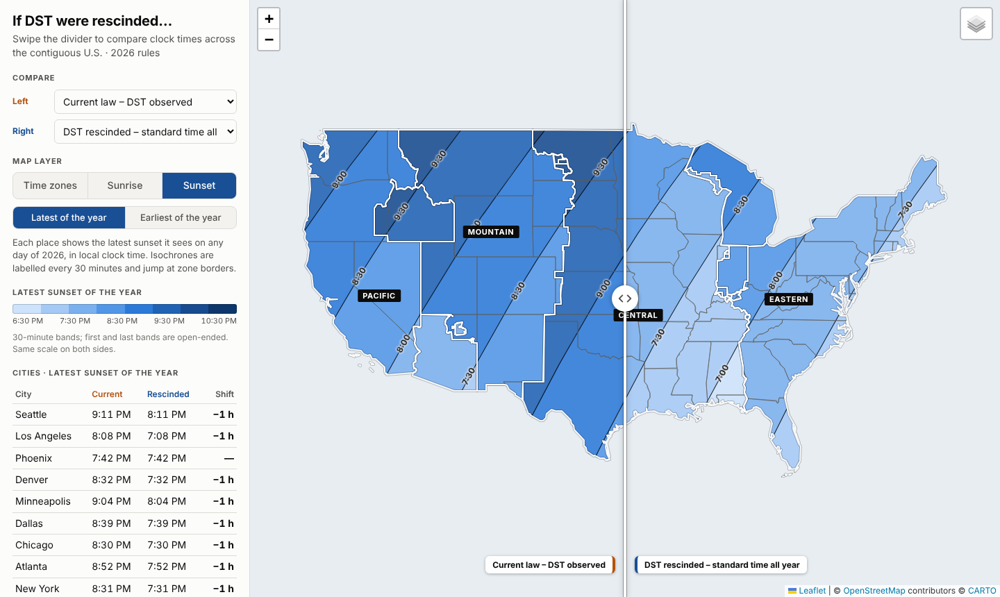

# rescinded-daylight-saving-time

A Python pipeline that builds an interactive **swipe map** of the contiguous U.S. showing what
changes on the clock if Daylight Saving Time is rescinded.

Drag the divider to compare two scenarios on a pan-and-zoomable basemap:

| Layer | What it shows |
|---|---|
| **Time zones** | Every legal CONUS time zone, coloured by UTC offset on a chosen date (slider across the DST period). |
| **Sunrise** | Latest / earliest sunrise of the year, as 30-minute colour bands with labelled isochrones. |
| **Sunset** | Latest / earliest sunset of the year, same style. |

Scenarios you can put on either side:

* **Current law** – today's DST rules (2nd Sunday of March to 1st Sunday of November).
* **DST rescinded** – every zone stays on standard time all year (Arizona already does).
* **Permanent DST** – clocks stay on summer time all year. Not what the repo is named for, but it is the
  case most "latest sunrise" maps show, and it makes the sunrise comparison meaningful.

A city table beside the map gives the same numbers for ten reference cities.



## Quick start

```bash
git clone https://github.com/aaronperry-dev/rescinded-daylight-saving-time.git
cd rescinded-daylight-saving-time
python -m venv .venv && source .venv/bin/activate
pip install -e ".[dev]"

rdst all                 # fetch -> process -> solar -> build   (about 15 s on a fast connection; ~55 MB download)
python -m http.server -d site 8000   # then open http://localhost:8000
```

`site/index.html` also works opened straight from disk; only the basemap tiles need the network.
`make site`, `make serve`, `make test` and `make clean` are provided as shortcuts.

## Pipeline

Each stage reads the previous stage's files from `data/`, so any one can be re-run alone.

| Command | Reads | Writes | What happens |
|---|---|---|---|
| `rdst fetch` | the internet | `data/raw/` | Downloads [Timezone Boundary Builder](https://github.com/evansiroky/timezone-boundary-builder) (legal zone polygons) and Natural Earth state outlines; records URL, SHA-256 and release tag in `manifest.json`. Cached; `--force` refreshes, `--tz-release 2026f` pins a release. |
| `rdst process` | `data/raw/` | `data/processed/conus_zones.geojson`, `conus_states.geojson`, `zone_rules.csv` | Streams the 170 MB boundary file (≈70 MB RAM), keeps zones that `zone.tab` assigns to the U.S., clips them to the lower 48 + DC, simplifies them **as a coverage** so shared borders stay shared, and derives each zone's standard offset, DST offset and DST start/end from the IANA tz database. `--year` (default: this year). |
| `rdst solar` | `data/processed/` | `data/processed/solar/*.json` | For every point and every day of the year computes sunrise/sunset, applies each scenario's UTC offset for that day, keeps the annual extreme, then contours it into colour bands and labelled isochrones clipped exactly to each zone. 12 datasets = {sunrise, sunset} × {latest, earliest} × 3 scenarios. |
| `rdst build` | `data/processed/` | `site/` | Assembles the static site: Leaflet (vendored), data, lazily-loaded sunrise/sunset datasets. `--no-solar` skips them. |
| `rdst all` | | | Runs all four. |

Run `rdst <stage> --help` for options. Everything downloaded is parsed as data only; nothing is executed.

## How the numbers are made

* **DST rules** come from Python's `zoneinfo` (IANA tzdata), sampled at local noon for each day of the
  year, not hard-coded. For 2026 that gives 8 March – 31 October as the last full DST day, matching U.S. law.
* **Sun times** use the NOAA solar-position approximation (equation of time + declination, 90.833° zenith).
  They agree with published almanac times to about a minute (see `tests/test_rules_and_solar.py`).
* **"Latest / earliest of the year"** is evaluated per pixel over all 365 days, so it can fall on different
  dates in different places. Under current law the *latest sunrise* is often the morning of the March clock
  change rather than a January day, which is why rescinding DST moves it by minutes and permanent DST by
  less than a full hour in some cities. The *earliest sunset* is identical under current law and rescinded DST.
* **Zone shapes** are the tz database's zones (county-level in places: Indiana, Kentucky, North Dakota, the
  Navajo Nation in `America/Denver`, Michigan's Menominee zone…), not state boundaries.
* **Colour**: UTC offsets use a validated single-hue ordinal ramp; sunrise/sunset bands use a 13-step
  sequential ramp sampled to each view's range. Each view has one scale shared by both sides of the swipe.

## Configuration

Everything tunable is in [`src/rdst/config.py`](src/rdst/config.py): colour ramps, band width
(`SOLAR_BIN_MINUTES`), per-view scales (`SOLAR_SCALES`), the city list (`CITIES`), simplification
tolerance, contour resolution. Add a scenario by extending `ZoneRule.offset_on` in `zones.py` and
`SCENARIOS` in `config.py`.

## Deploy to GitHub Pages

`.github/workflows/pages.yml` runs the tests, builds the site and publishes it on every push to `main`
(and monthly, to pick up new tzdata / boundary releases). In the repository settings choose
**Pages → Source: GitHub Actions**. Generated output (`data/`, `site/`) is git-ignored.

## Layout

```
src/rdst/
  config.py     constants, colours, scales, cities
  fetch.py      stage 1  download + provenance manifest
  zones.py      stage 2  CONUS zones, DST rules, states, zone labels
  solar.py      stage 3  sun maths, annual extremes, contours, isochrones
  build.py      stage 4  static site assembly
  pipeline.py   stage orchestration
  cli.py        `rdst` command
  web/          index.html, app.js (swipe + layers), style.css, vendor/leaflet
tests/          rules, sun-time accuracy, synthetic end-to-end pipeline
```

## Data & licences

* Zone boundaries: [Timezone Boundary Builder](https://github.com/evansiroky/timezone-boundary-builder),
  © OpenStreetMap contributors, [ODbL](https://opendatacommons.org/licenses/odbl/). Maps that use it must keep
  that attribution (the site's footer does).
* State outlines: [Natural Earth](https://www.naturalearthdata.com/) (public domain).
* DST rules: [IANA tz database](https://www.iana.org/time-zones) (public domain).
* Map library: [Leaflet](https://leafletjs.com/) 1.9.4 (BSD-2-Clause), vendored in `src/rdst/web/vendor/leaflet`.
* Basemap tiles are loaded at view time from CARTO / OpenStreetMap / Esri under their own terms; switch or
  self-host them in `app.js` for heavy traffic (the OSM tile servers in particular are not meant for it).

No licence file is included yet: add the one you want before publishing.
